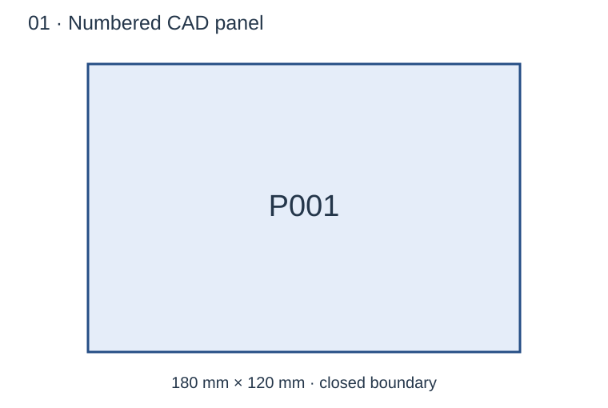
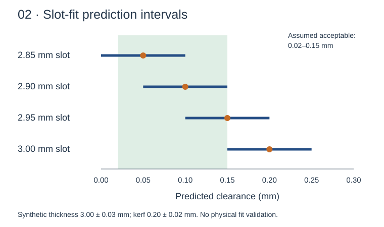
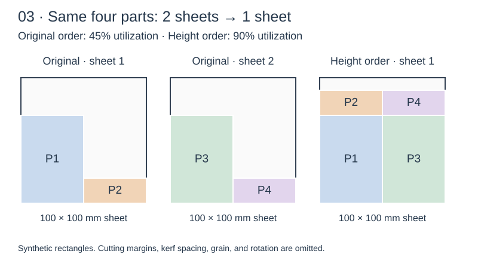
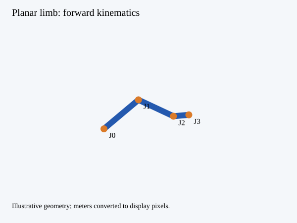
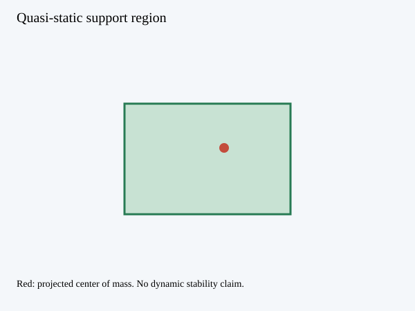

# Build for Humanity

### Build Your Own Technology: Software → Physical Systems → Humanoid Robotics

**Learn by building AI, software, CAD/BIM, digital fabrication, robotics, sensors, and material systems. Then measure whether the result helps people.**

**Compiled by Prapawit Intun — MIT Affiliate**  
An independent educational collection for studying technologies of the future.

**60 learning paths · 8 tracks · 7 runnable Python labs · 12 humanoid topics**

[First project in 10 minutes](GETTING_STARTED.md) · [CAD → robotics demo](labs/07-cad-to-robotics/README.md) · [Humanoid robotics](HUMANOID.md) · [Impact roadmap](IMPACT_ROADMAP.md) · [Original build-your-own-x](upstream/README.md) · [Contribute](CONTRIBUTING.md) · [ภาษาไทย](README.th.md)

## See what you can build

### 1. A numbered CAD panel



Create a closed, dimensioned SVG with a part ID. [Run lab 1](labs/01-panel-geometry/README.md).

### 2. A slot-fit prediction



Explore how thickness and kerf uncertainty affect predicted clearance. These are synthetic inputs, not measured fit results. [Run lab 2](labs/02-fit-predictor/README.md).

### 3. A sheet-packing comparison



Compare the same four parts: **2 sheets / 45% utilization → 1 sheet / 90% utilization** on this example. Cutting margins and kerf spacing are omitted. [Run lab 3](labs/03-sheet-packing/README.md).

These vector previews illustrate the numerical examples. See [inputs and interpretation](assets/PREVIEW_NOTES.md). Running the seven core labs requires only standard Python.

## What is new

This edition combines the earlier 40-category package with 20 new paths: **12 for humanoid robotics** and **8 for technology serving practical human needs**. CodeCrafters' original collection remains an attributed, pinned upstream reference. Its text and banner are not copied into this archive.

The ambition is to connect learning with useful outcomes: build → compare with a baseline → document failures → invite replication → pilot with intended users. A catalog alone is not evidence of social impact.

## Build your first project in 10 minutes

Follow the [guided walkthrough](GETTING_STARTED.md) to create a panel, change its dimensions, compare layouts, and inspect robot pick targets. The suggested time assumes Python is installed; setup time varies.

For a first result, download and extract the repository, open a terminal in its root directory, and run:

```bash
python labs/01-panel-geometry/main.py --width 180 --height 120 --id P001
```

Open **`outputs/panel.svg`** in a browser. You should see a **180 × 120 mm** rectangle labeled **P001**. Change `--width`, `--height`, or `--id` and rerun.

**Requirements:** Python 3.10 or later. No API key, robot hardware, or third-party package is needed for the core labs. On Windows, try `py`; on macOS/Linux, your Python command may be `python3`.

## CAD → fabrication → robotics

The [integrated lesson](labs/07-cad-to-robotics/README.md) connects labeled parts to a sheet layout, dependency order, robot-frame target coordinates, and checked planar-arm joint angles.

```bash
python labs/07-cad-to-robotics/main.py
python scripts/validate.py
```

It writes `outputs/cad-to-robotics.json`. The supplied case yields **P1 → P2 → P3 → P4**, uses one sheet after height sorting, and checks the arm endpoint against each pick target. It does not provide a collision-free trajectory or physical robot execution.

## Seven working starter labs

| Lab | Result | What the evidence establishes |
| --- | --- | --- |
| [Panel geometry](labs/01-panel-geometry/README.md) | Numbered SVG panel in millimeters | A closed geometric boundary |
| [Fit prediction](labs/02-fit-predictor/README.md) | Clearance intervals on synthetic inputs | Simplified clearance calculations |
| [Sheet packing](labs/03-sheet-packing/README.md) | Baseline comparison on four rectangles | Improvement on one supplied case |
| [Limb kinematics](labs/04-limb-kinematics/README.md) | Joint positions, Jacobian, SVG limb diagram | Analytic geometry checked by finite differences |
| [Static balance](labs/05-static-balance/README.md) | Support polygon, signed margin, SVG diagram | A quasi-static geometric margin |
| [Human supervision](labs/06-human-supervision/README.md) | Task approval, stop, and reset event log | Software state-transition behavior |
| [CAD → fabrication → robotics](labs/07-cad-to-robotics/README.md) | Sheet layout, dependency order, and inverse-kinematics targets | Consistent units and reachable endpoints on the supplied case |

## Example outputs





These diagrams are generated by labs 4 and 5. They visualize the teaching calculations, not a complete humanoid simulation.

## Choose a path

| Goal | Suggested sequence |
| --- | --- |
| Learn software foundations | Original [build-your-own-x](upstream/README.md) → programming languages → databases → networking |
| Connect design to production | CAD → planar grammar → fit experiments → nesting → assembly planning |
| Learn humanoid robotics | Kinematics → descriptions → contact dynamics → balance → locomotion → manipulation → learning → evaluation |
| Build accessible tools | Assistive interfaces → sensors → user-defined tasks → participatory evaluation |
| Reduce material waste | Repairable hardware → circular material tracking → comparable production trials |

The [humanoid guide](HUMANOID.md) lists stages and prerequisites. The [impact roadmap](IMPACT_ROADMAP.md) defines pilots, measures, and evidence gates.

## Technology catalog

Each category provides a challenge and learning references. Some links are books or tutorials; others are tool documentation, standards, or codebases. A reference is not automatically an end-to-end tutorial for the proposed challenge.

## AI & Data

| Technology | Build challenge | Learning references |
| --- | --- | --- |
| [Neural networks](categories/neural-networks.md) | Train a small classifier and report held-out accuracy. | [micrograd](https://github.com/karpathy/micrograd) · [pytorch.org](https://pytorch.org/tutorials/) |
| [Language models](categories/language-models.md) | Train a character-level language model on a small public-domain text. | [nanoGPT](https://github.com/karpathy/nanoGPT) · [LLMs-from-scratch](https://github.com/rasbt/LLMs-from-scratch) |
| [Retrieval systems](categories/retrieval.md) | Index ten documents and measure retrieval against ten labeled questions. | [sbert.net](https://www.sbert.net/) · [faiss](https://github.com/facebookresearch/faiss) |
| [Computer vision](categories/computer-vision.md) | Detect geometric shapes in a photo and measure detection errors. | [docs.opencv.org](https://docs.opencv.org/4.x/d9/df8/tutorial_root.html) · [pytorch.org](https://pytorch.org/tutorials/) |
| [Speech interfaces](categories/speech.md) | Transcribe a short recording, then count word errors against a transcript. | [whisper](https://github.com/openai/whisper) · [developer.mozilla.org](https://developer.mozilla.org/en-US/docs/Web/API/Web_Speech_API) |
| [Search engines](categories/search-engines.md) | Implement an inverted index and rank a small collection of documents. | [nlp.stanford.edu](https://nlp.stanford.edu/IR-book/) · [sqlite.org](https://sqlite.org/fts5.html) |
| [Knowledge graphs](categories/knowledge-graphs.md) | Represent people, places, materials, and evidence as a queryable graph. | [networkx.org](https://networkx.org/documentation/stable/tutorial.html) · [w3.org](https://www.w3.org/TR/rdf11-primer/) |
| [Data visualization](categories/data-visualization.md) | Build a participation chart that links every mark back to a source record. | [observablehq.com](https://observablehq.com/@d3/learn-d3) · [vega.github.io](https://vega.github.io/vega-lite/tutorials/getting_started.html) |

## Software Systems

| Technology | Build challenge | Learning references |
| --- | --- | --- |
| [Databases](categories/databases.md) | Implement a tiny append-only key-value store with recovery after restart. | [cstack.github.io](https://cstack.github.io/db_tutorial/) · [sqlite.org](https://sqlite.org/docs.html) |
| [Programming languages](categories/programming-languages.md) | Write a tokenizer, parser, and evaluator for arithmetic expressions. | [craftinginterpreters.com](https://craftinginterpreters.com/) · [llvm.org](https://llvm.org/docs/tutorial/) |
| [Operating systems](categories/operating-systems.md) | Run a teaching OS in an emulator and explain a system call. | [pdos.csail.mit.edu](https://pdos.csail.mit.edu/6.1810/) · [os.phil-opp.com](https://os.phil-opp.com/) |
| [Network protocols](categories/network-protocols.md) | Write a local TCP client and server with framed messages. | [beej.us](https://beej.us/guide/bgnet/) · [docs.python.org](https://docs.python.org/3/library/socket.html) |
| [Web servers](categories/web-servers.md) | Serve a static page and return correct status codes for missing files. | [developer.mozilla.org](https://developer.mozilla.org/en-US/docs/Web/HTTP) · [docs.python.org](https://docs.python.org/3/library/http.server.html) |
| [Browser engines](categories/browser-engines.md) | Render a small subset of HTML and explain which browser features are missing. | [browser.engineering](https://browser.engineering/) |
| [Version control](categories/version-control.md) | Store file snapshots by content hash and reconstruct an earlier revision. | [git-scm.com](https://git-scm.com/book/en/v2) · [wyag.thb.lt](https://wyag.thb.lt/) |
| [Containers](categories/containers.md) | Containerize a small program and document its filesystem and process boundaries. | [docs.docker.com](https://docs.docker.com/get-started/) |

## Spatial Design

| Technology | Build challenge | Learning references |
| --- | --- | --- |
| [CAD geometry](categories/cad-geometry.md) | Export a dimensioned rectangular panel as SVG; inspect units and closure. | [cadquery.readthedocs.io](https://cadquery.readthedocs.io/en/latest/) · [dev.opencascade.org](https://dev.opencascade.org/doc/overview/html/) |
| [Parametric modeling](categories/parametric-modeling.md) | Create a panel that updates consistently when length and thickness change. | [docs.blender.org](https://docs.blender.org/manual/en/latest/modeling/geometry_nodes/) · [sverchok](https://github.com/nortikin/sverchok) |
| [BIM and IFC](categories/bim-ifc.md) | Create or inspect one wall with dimensions, identity, and material data in IFC. | [docs.ifcopenshell.org](https://docs.ifcopenshell.org/) · [docs.bonsaibim.org](https://docs.bonsaibim.org/) |
| [Visual programming](categories/visual-programming.md) | Evaluate a small directed node graph with explicit cycle detection. | [sverchok](https://github.com/nortikin/sverchok) · [docs.blender.org](https://docs.blender.org/manual/en/latest/modeling/geometry_nodes/) |
| [Shape grammars](categories/shape-grammars.md) | Define and apply three explicit geometric rewrite rules, preserving an operation log. | [ocw.mit.edu](https://ocw.mit.edu/courses/4-540-introduction-to-shape-grammars-i-fall-2018/) |
| [Planar grammar](categories/planar-grammar.md) | Generate numbered panels and record integration, splitting, and rejoining rules. | [fabacademy.org](https://fabacademy.org/2018/docs/FabAcademy-Tutorials/) · [cadquery.readthedocs.io](https://cadquery.readthedocs.io/en/latest/) |
| [3D rendering](categories/3d-rendering.md) | Render a sphere, light, and camera; compare changes in sampling noise. | [raytracing.github.io](https://raytracing.github.io/books/RayTracingInOneWeekend.html) · [pbr-book.org](https://www.pbr-book.org/) |
| [Physics simulation](categories/physics-simulation.md) | Simulate a falling rigid body and compare trajectory to an analytic baseline. | [mujoco.readthedocs.io](https://mujoco.readthedocs.io/en/stable/) |

## Digital Fabrication

| Technology | Build challenge | Learning references |
| --- | --- | --- |
| [Laser cutting](categories/laser-cutting.md) | Prepare a 2D fit coupon and document measured thickness, kerf, and fit outcomes. | [fabacademy.org](https://fabacademy.org/2018/docs/FabAcademy-Tutorials/) |
| [CNC workflows](categories/cnc.md) | Generate a simple simulated toolpath and record stock, tool, and clearance assumptions. | [linuxcnc.org](https://linuxcnc.org/docs/html/) · [camotics.org](https://camotics.org/) |
| [3D printing](categories/3d-printing.md) | Print a dimension coupon and measure shrinkage against the nominal dimensions. | [help.prusa3d.com](https://help.prusa3d.com/) · [marlinfw.org](https://marlinfw.org/docs/basics/install.html) |
| [Sheet nesting](categories/sheet-nesting.md) | Compare original-order and height-sorted packing on the same rectangular part list. | [developers.google.com](https://developers.google.com/optimization/pack/bin_packing) · [SVGnest](https://github.com/Jack000/SVGnest) |
| [Assembly planning](categories/assembly-planning.md) | Create a dependency graph and derive an order; test access with a physical mockup. | [networkx.org](https://networkx.org/documentation/stable/reference/algorithms/dag.html) |
| [Physical verification](categories/physical-verification.md) | Predict fit on unseen coupons, then compare predictions with measured outcomes. | [itl.nist.gov](https://www.itl.nist.gov/div898/handbook/) |

## Hardware & Robotics

| Technology | Build challenge | Learning references |
| --- | --- | --- |
| [Microcontrollers](categories/microcontrollers.md) | Blink an LED and record its timing using a second observation method. | [docs.arduino.cc](https://docs.arduino.cc/learn/) · [docs.micropython.org](https://docs.micropython.org/en/latest/) |
| [Analog and digital sensors](categories/sensors.md) | Measure a variable input and a binary input; plot both against a reference. | [docs.arduino.cc](https://docs.arduino.cc/learn/) · [learn.adafruit.com](https://learn.adafruit.com/) |
| [Soft sensors and wearables](categories/soft-sensors.md) | Build a low-voltage textile switch and compare it with a resistive pressure sample. | [class.textile-academy.org](https://class.textile-academy.org/tutorials/) · [kobakant.at](https://www.kobakant.at/DIY/) |
| [Robot kinematics](categories/robot-kinematics.md) | Compute forward kinematics for a two-link arm and test known configurations. | [modernrobotics.northwestern.edu](https://modernrobotics.northwestern.edu/nu-gm-book-resource/) · [docs.ros.org](https://docs.ros.org/en/jazzy/Tutorials.html) |
| [Robot simulation](categories/robot-simulation.md) | Move a simulated robot to a target and log pose error over repeated trials. | [gazebosim.org](https://gazebosim.org/docs/latest/) · [mujoco.readthedocs.io](https://mujoco.readthedocs.io/en/stable/) |
| [PCB design](categories/pcb-design.md) | Design a simple LED board and run schematic and board rule checks. | [docs.kicad.org](https://docs.kicad.org/) · [learn.adafruit.com](https://learn.adafruit.com/) |

## Materials & Community

| Technology | Build challenge | Learning references |
| --- | --- | --- |
| [Biomaterials](categories/biomaterials.md) | Document a material sample with recipe provenance, thickness, transparency, and drying conditions. | [class.textile-academy.org](https://class.textile-academy.org/classes/2024-25/week07/) · [class.textile-academy.org](https://class.textile-academy.org/tutorials/) |
| [Textile structures](categories/textile-structures.md) | Make a repeatable knitted or woven swatch and compare stretch across directions. | [class.textile-academy.org](https://class.textile-academy.org/tutorials/) |
| [Participatory mapping](categories/participatory-mapping.md) | Collect consented place annotations, map them, and retain their provenance. | [leafletjs.com](https://leafletjs.com/examples/quick-start/) · [wiki.openstreetmap.org](https://wiki.openstreetmap.org/wiki/Beginners%27_guide) |
| [Circular material tracking](categories/circular-material-tracking.md) | Track a material batch through fabrication, assembly, reuse, and measured waste. | [ref.gs1.org](https://ref.gs1.org/standards/epcis/) · [w3.org](https://www.w3.org/TR/prov-overview/) |

## Humanoid Robotics

| Technology | Build challenge | Learning references |
| --- | --- | --- |
| [Humanoid morphology](categories/humanoid-morphology.md) | Compare two humanoid model trees and document joint counts, link masses, and license differences. | [mujoco_menagerie](https://github.com/google-deepmind/mujoco_menagerie) · [icub-main](https://github.com/robotology/icub-main) |
| [Robot descriptions and joint limits](categories/humanoid-description.md) | Describe a simple articulated body with explicit frames, units, joint axes, and limits; validate its tree structure. | [urdf](https://github.com/ros/urdf) · [mujoco.readthedocs.io](https://mujoco.readthedocs.io/en/stable/) |
| [Humanoid limb kinematics](categories/humanoid-kinematics.md) | Compute limb positions and an analytic Jacobian, then compare it with finite differences. | [pinocchio](https://github.com/stack-of-tasks/pinocchio) · [modernrobotics.northwestern.edu](https://modernrobotics.northwestern.edu/nu-gm-book-resource/) |
| [Rigid-body dynamics and contacts](categories/humanoid-dynamics.md) | Simulate a constrained contact example and report sensitivity to time step, mass, and friction assumptions. | [drake.mit.edu](https://drake.mit.edu/) · [mujoco.readthedocs.io](https://mujoco.readthedocs.io/en/stable/) |
| [Static balance and support regions](categories/humanoid-balance.md) | Compute a support polygon and the signed margin of a projected center of mass; test edge and outside cases. | [underactuated.mit.edu](https://underactuated.mit.edu/) · [drake.mit.edu](https://drake.mit.edu/) |
| [Biped locomotion](categories/humanoid-locomotion.md) | Reproduce a simulation locomotion baseline with fixed seeds and report falls, tracking error, and compute requirements. | [mujoco_playground](https://github.com/google-deepmind/mujoco_playground) · [ksim](https://github.com/kscalelabs/ksim) |
| [Manipulation and grasping](categories/humanoid-manipulation.md) | Plan a simulated reach and grasp, measuring target error, collisions, and success across repeated trials. | [moveit.picknik.ai](https://moveit.picknik.ai/main/index.html) · [lerobot](https://github.com/huggingface/lerobot) |
| [Teleoperation and demonstrations](categories/humanoid-teleoperation.md) | Record time-stamped simulated joint commands and replay them with limits, latency measurements, and a stop control. | [huggingface.co](https://huggingface.co/docs/lerobot/index) · [ros2_control](https://github.com/ros-controls/ros2_control) |
| [Imitation learning](categories/humanoid-imitation.md) | Train on demonstration episodes and evaluate on held-out episodes and object positions without data leakage. | [huggingface.co](https://huggingface.co/docs/lerobot/index) · [lerobot](https://github.com/huggingface/lerobot) |
| [Reinforcement learning for robots](categories/humanoid-rl.md) | Compare a learned simulated policy with a fixed controller under the same episode budget, seeds, and perturbations. | [rsl_rl](https://github.com/leggedrobotics/rsl_rl) · [IsaacLab](https://github.com/isaac-sim/IsaacLab) |
| [System identification and sim-to-real](categories/humanoid-sim-to-real.md) | Fit a simulated actuator parameter on training traces and report prediction error on withheld traces; document the remaining hardware gap. | [mujoco_playground](https://github.com/google-deepmind/mujoco_playground) · [unitree_mujoco](https://github.com/unitreerobotics/unitree_mujoco) |
| [Human supervision and stop behavior](categories/humanoid-supervision.md) | Require task approval in a software state machine, latch a stop, and show that execution cannot resume without reset and new approval. | [docs.python.org](https://docs.python.org/3/library/enum.html) · [w3.org](https://www.w3.org/WAI/tutorials/) |

## Technology for Public Benefit

| Technology | Build challenge | Learning references |
| --- | --- | --- |
| [Accessible assistive interfaces](categories/assistive-interfaces.md) | Build a keyboard-accessible task interface, then measure task completion and errors with consenting participants. | [w3.org](https://www.w3.org/WAI/tutorials/) · [docs.arduino.cc](https://docs.arduino.cc/learn/) |
| [Repairable hardware](categories/repairable-hardware.md) | Document a modular sensor enclosure with a bill of materials, replaceable parts, and a timed disassembly trial. | [docs.kicad.org](https://docs.kicad.org/) · [fabacademy.org](https://fabacademy.org/2018/docs/FabAcademy-Tutorials/) |
| [Environmental sensing](categories/environmental-sensing.md) | Calibrate a low-voltage environmental sensor against a reference and report error, missing data, and maintenance effort. | [docs.arduino.cc](https://docs.arduino.cc/learn/) · [docs.getodk.org](https://docs.getodk.org/) |
| [Community energy data](categories/community-energy.md) | Use recorded energy data to compare an intervention against a baseline, recording units and confounding factors. | [docs.openenergymonitor.org](https://docs.openenergymonitor.org/) · [itl.nist.gov](https://www.itl.nist.gov/div898/handbook/) |
| [Community response mapping](categories/response-mapping.md) | Create an offline-capable map of synthetic service requests and test data export and recovery after a connection loss. | [qgis.org](https://www.qgis.org/resources/hub/) · [docs.getodk.org](https://docs.getodk.org/) |
| [Circular manufacturing](categories/circular-manufacturing.md) | Compare material input, usable parts, scrap, and reassembly effort for two production plans on the same design. | [ref.gs1.org](https://ref.gs1.org/standards/epcis/) · [itl.nist.gov](https://www.itl.nist.gov/div898/handbook/) |
| [Offline maker education](categories/offline-education.md) | Package a small lesson that runs offline and test setup time and successful completion on a second machine. | [docs.python.org](https://docs.python.org/3/tutorial/) · [docs.micropython.org](https://docs.micropython.org/en/latest/) |
| [Participatory impact evaluation](categories/participatory-evaluation.md) | Co-define one useful outcome with intended users and compare a prototype against their existing workflow using consented evidence. | [docs.getodk.org](https://docs.getodk.org/) · [itl.nist.gov](https://www.itl.nist.gov/div898/handbook/) |
## Share one useful demo

Start with the [CAD-to-robotics example](labs/07-cad-to-robotics/README.md), show its measured output, and link readers to the exact run command. See [SHARING.md](SHARING.md) for a focused demo brief and suggested wording for maker, computational-design, and robotics communities. Follow each community's posting rules.

## How to contribute

Improve one lesson with runnable code, clear prerequisites, expected outputs, and a recorded failure case. Submit a reproducible change rather than an untested capability claim. See [CONTRIBUTING.md](CONTRIBUTING.md).

If this collection helps you, share a build or suggest a correction. The goal is useful learning and reproducible work.

## Reproduce the local checks

Run `python scripts/run_labs.py` to execute all seven examples and the validator. Logs are saved in `examples/results/` and summarized in `validation-report.json`. The included logs record the release checks; rerunning the command replaces them with your local results.

## Evidence and scope

Validate grammar correctness, physical prediction, and production improvement separately. For robots, validate kinematic calculations, simulated task performance, and physical performance separately. An approval state machine does not certify a robot safety system; a center-of-mass projection does not prove dynamic balance.

External frameworks may require substantial dependencies, GPUs, or hardware. They were linked and checked for reachability, not installed and benchmarked for this release. No social-impact or full-humanoid performance claim has been demonstrated by this archive.

## Attribution and licensing

Compiled by **Prapawit Intun — MIT Affiliate**. This is an independent collection, not an official MIT publication.

The original [CodeCrafters build-your-own-x](https://github.com/codecrafters-io/build-your-own-x) retains its authorship. See the [upstream record](upstream/README.md) and [source notes](SOURCES.md). Original local text and starter code are under [MIT License](LICENSE); external content keeps its own terms.
